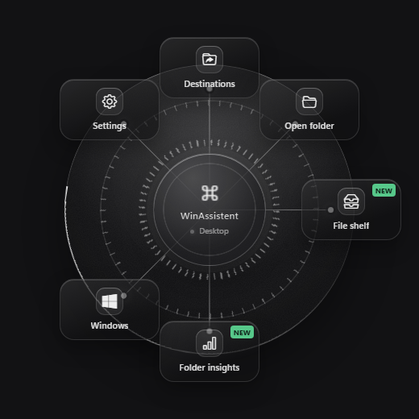
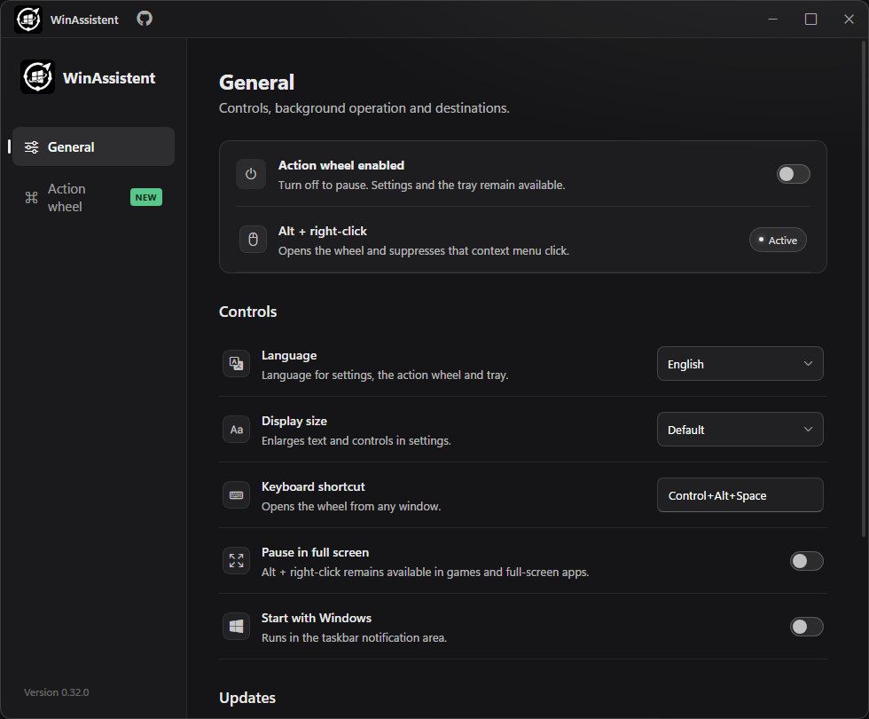
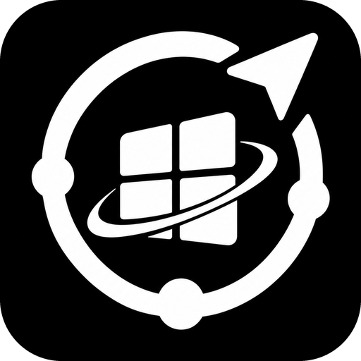

# WinAssistent

WinAssistent puts the actions you use most within reach of your cursor. Open the action wheel from Windows Explorer or the desktop, choose a direction, and work with the current folder or selected files without digging through menus.

The wheel adapts to its context. It can open a terminal in the current folder, copy file details, calculate a SHA-256 hash, compare files, or send a selection to a saved destination. You can arrange eight actions around the wheel, choose a ready-made profile, and add your own programs.

> **Status:** WinAssistent is in beta. Download the current Windows installer from the [Releases page](https://github.com/mambuzrrr/WinAssistent/releases). Changes on `main` may not yet be included in the latest installer.

## Preview

**Action wheel**



**Settings**



## At a glance

- **Open it anywhere:** Use `Ctrl+Alt+Space` or `Alt` + right-click. A short click leaves the wheel open; hold and drag at least 60 px toward an action to select it on release.
- **Work with files:** Copy names, paths, Markdown path lists, details, or the contents of a small text file; calculate or verify SHA-256; compare two files; inspect folder size; find duplicate files; batch rename with a preview; and check which processes lock a file.
- **Share a folder listing:** Preview the selected folders as a readable tree, optionally include subfolders, and copy the result to the clipboard.
- **Move things quickly:** Copy or move selections to saved, open, or recent folders. Cancellable transfers show progress and handle name collisions.
- **Prepare images:** Create smaller JPG/PNG copies without image metadata, keep an unchanged copy with metadata, or combine selected images into a PDF. The original files stay in place.
- **Extract ZIP archives:** Select up to 20 ZIP files, preview their contents and destination folders, then extract the archives you choose. Existing folders and files are never overwritten.
- **Save a screenshot where you need it:** Copy an image to the clipboard, open the wheel in a folder, preview it, and save it there as a PNG.
- **Keep your tools close:** Launch a terminal in the current folder, open Windows utilities, or run your own EXE with configured arguments and working directory. Custom program icons appear in the wheel.
- **Make it yours:** Choose Standard, Developer, or Gamer, or build a Custom wheel with eight actions. Developer actions can recognize a project root from common project files.
- **Stay out of the way:** The app runs in the notification area. You can pause the wheel, disable the mouse gesture in full-screen apps, and adjust the interface scale.

Actions that need a file selection are unavailable when WinAssistent cannot identify one reliably. The wheel also works on the desktop; virtual items such as Recycle Bin are excluded from file actions.

## Getting started

WinAssistent requires Windows 11. Download the installer from the [official Releases page](https://github.com/mambuzrrr/WinAssistent/releases). The installer creates Start Menu and desktop shortcuts. Double-click the tray icon to open settings; the tray menu also lets you open the wheel, pause it, or quit.

To run the source locally, install Node.js, npm, and the Visual Studio C++ build tools, then run:

```powershell
npm install
npm start
```

The native module is built during setup. To rebuild it explicitly, run `npm run native:build`.

## Settings and profiles

**General** contains the wheel toggle, activation options, settings display size, language, quick destinations, and update controls. **Action wheel** contains the wheel size, profile selection, and eight slots. Standard, Developer, and Gamer are ready to use; Custom lets you assign each direction and add programs.

On first launch, a short **Getting started** page explains how to open the wheel and use it with a selection. You can open the same page later from settings.

The Standard profile adapts its actions to the selection. With no selection, saved and open Explorer folders appear directly on the wheel, alongside a scan of the current folder's largest files. A selected folder brings size and transfer actions forward; multiple files surface duplicate finding, bundling, and renaming. Image selections show sharing and PDF tools. Use the arrow buttons in the image panel to set the PDF page order before creating the file. Smart Copy appears only when files or folders are selected.

When you compare two supported text files, the result shows the first differing line and column before the file details and SHA-256 hashes. Other file types still use the hash comparison.

You can also select two folders to compare their contents. WinAssistent lists entries present on only one side and files whose size or contents differ. Folder links are not followed. Large scans show which entries could not be checked, so an incomplete result is not mistaken for a match.

When the scan is complete, you can select missing files and copy them in either direction from the comparison window. Changed files are never copied by this action, and existing destination files are never overwritten.

The file shelf lets you collect up to 30 files or folders from different locations while WinAssistent is running. Open the wheel on a selection and choose **File shelf → Add selection**. Open it again to review the list, remove entries, and preview the destination paths before copying or moving everything to a saved or open folder. Existing names receive a numbered suffix. Successfully transferred entries leave the shelf; failed entries remain for retry. The shelf is cleared when WinAssistent exits.

English is the default for new installations. German is also available. Your selected language is preserved when you update.

Profiles can be exported to and imported from JSON. An export includes custom program paths, arguments, and working directories, so review it before sharing. Importing a profile does not change your hotkey or quick destinations. Save the imported profile to apply it.

## Updates

Installed release builds check GitHub Releases for updates at startup and periodically afterward. When a newer version is available, a green update icon appears in the title bar. You can also check, download, and install from settings. Development builds started with `npm start` do not use the release feed.

The updater shows a prompt only when a newer published version is available.

## Building

```powershell
npm run dist
```

This creates an unsigned Windows installer in `dist/`. For a release build with the GitHub update source embedded, run `npm run release:build`. That command creates the installer and update metadata locally; it does not upload them. See [RELEASE.md](RELEASE.md) for the publication checklist.

## Contributing

Ideas and bug reports are welcome in [Issues](https://github.com/mambuzrrr/WinAssistent/issues). Please include your WinAssistent version, what you expected, what happened, and steps to reproduce it. See [CONTRIBUTING.md](CONTRIBUTING.md) before opening a pull request.

The application source is licensed under [GPL-3.0-only](LICENSE). Third-party dependencies retain their own licenses. WinAssistent's name and logo identify the official project.

## If Windows blocks the installer

WinAssistent's beta installers are currently unsigned. On some Windows 11 PCs, **Smart App Control** may block the installer because it cannot verify the publisher. Download WinAssistent only from this repository's [Releases page](https://github.com/mambuzrrr/WinAssistent/releases) and check that the blocked filename matches the release you intended to install.

Smart App Control does not offer an exception for just one app. If you choose to turn it off, open **Windows Security → App & browser control → Smart App Control settings → Off**, then run the installer again. This changes protection for the whole PC, not only WinAssistent. Whether you can turn it back on without resetting Windows depends on your Windows version and configuration, so check the available options before switching it off. You can instead keep Smart App Control enabled and wait for a signed WinAssistent release.

For details, see [Microsoft's Smart App Control FAQ](https://support.microsoft.com/en-gb/windows/security/threat-malware-protection/smart-app-control-frequently-asked-questions). A **Microsoft Defender SmartScreen** warning is a different message and may offer different choices.

## LOGO

<p align="center">
  
</p>
